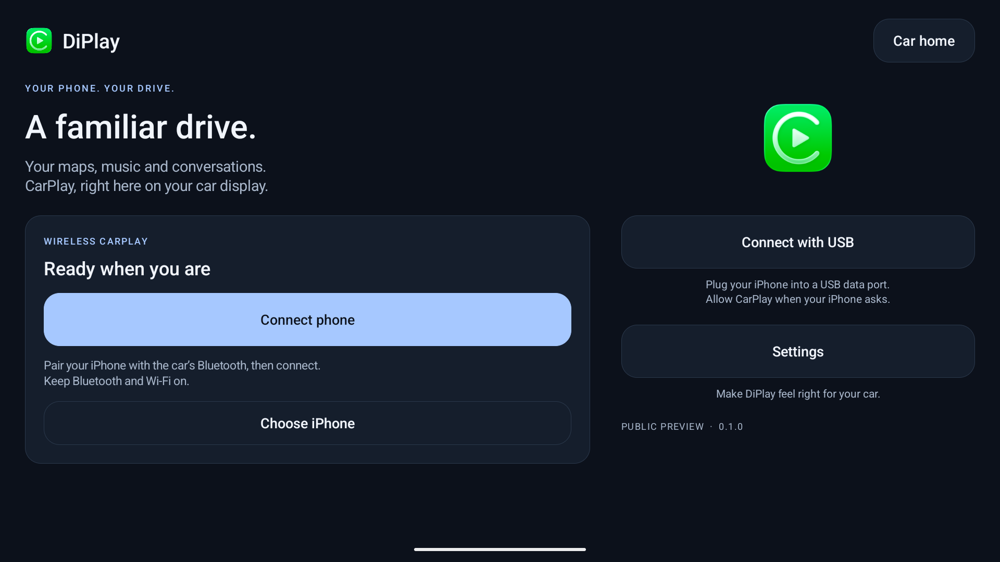

# DiPlay

[English](README.md) · [简体中文](README.zh-CN.md) · [繁體中文](README.zh-TW.md) · [日本語](README.ja.md)

**対応する BYD の Android 車載ユニット向けの CarPlay です。** 有線と無線に対応し、おなじみの DiAuto インターフェースを備えています。独立したアプリです：`com.shihab.diplay`。

> **BYD のサポート範囲：** これらのプロジェクトは BYD の車を対象としています。他のブランドでも動作する場合がありますが、他のブランドはサポート対象外であり、サポートの追加やブランド固有の非互換性を修正する予定はありません。

[ダウンロードとウェブサイト](https://shihabal3amri.github.io/DiPlay/) · [リリース](https://github.com/shihabal3amri/DiPlay/releases/tag/v0.2.22) · [問題を報告](https://github.com/shihabal3amri/DiPlay/issues/new/choose)

## 0.2.22 — 公開プレビュー

iPhone ではなく、**車**にインストールしてください。利用にあたって、脱獄、ドングル、Mac、アカウント、認証サーバーは必要ありません。CarPlay の基本機能には ADB は不要ですが、オプションのダッシュボード、バッテリー、車輪速、停車中の動画の機能には ADB が必要です。車載ユニットが APK のインストールを許可している必要があります。APK は Android 7.0+（API 24）に対応しています。Android 7.0–8.1 では、有線 CarPlay は 1 台の車で動作が確認されており、無線はまだ実車で確認されていません。無線は Wi-Fi Direct、車の既存のホットスポット、または既存の Wi-Fi／同一 LAN に対応しています。Android 7.0–9 の Wi-Fi Direct は、ファームウェアに依存する旧来の方式を使い、生成されたグループ認証情報を用いますが、要求した周波数は検証されません。[Android 9 の Wi-Fi Direct](docs/ANDROID9_WIFI_DIRECT.md) を参照してください。Android 10+ では、ネゴシエートされたグループの周波数を検証します。

- ローカル認証による有線 USB と無線の CarPlay。
- 検証済みのファームウェアでは、矢印、距離、通り名を表示する BYD HUD ナビゲーション。
- 車載ホットスポットへの対応、オーディオバッファリングの改善、受信診断の保存。
- アドレスの自動検出、固定チャンネルによる Wi-Fi のフォールバック、成功した設定の記憶。
- アイコン／テキストのサイズ、解像度、フレームレート。表示の変更を適用すると CarPlay が再接続されます。
- 診断情報のローカルでのエクスポート。レポートは共有を選んだ場合にのみ送信されます。
- DiAuto と並行して別アプリとしてインストール可能。投影アプリは一度に 1 つだけ実行してください。

これは **Apple 認定製品ではありません**。APK には、公開されている Carlinkit のファームウェアから復元された実験的なアクセサリ ID が同梱されており、DiPlay 用に新たに発行された MFi ID ではありません。同梱の秘密鍵は抽出可能です。今後の iOS アップデート後も受け入れられるか、車載ユニット間での信頼性、そしてその ID が一般配布に適しているかは未解決です。このリリースはコミュニティによるテストを募るものであり、あらゆる環境での互換性を保証するものではありません。

以前のリリースは開発用の DiLink5.1 の車でテストされました：フロントガラスへのライブ案内と通り名が動作し、車載ホットスポットで CarPlay が起動するようになり、Wi-Fi Direct の性能が大幅に向上しています。オーディオのアンダーラン回復は 0.2.15 で改善されました。残っている音切れについては最新の診断レポートが必要です。0.2.16 のソフトウェア Opus マイクのフォールバックは、BOS Mini A1 車載ユニット（Android 9）と iOS 27 の iPhone 12 で受け入れられました。フローティングマップのテストビルドは開発用の DiLink 5.1 の車にインストールされ、そのフィードバックが 0.2.9 でのピンチ操作の修正につながりました。以前の車輪速と動画のコントリビューションは、DiLink 5.0 の BYD Tang と iOS 27 の iPhone 15 Pro でテストされました。トンネル内での車輪速による推測航法はまだ検証されていません。より広い車載ユニットや iOS との互換性は保証されません。HUD のファームウェアの対象範囲とクリーンアップの制限は [BYD ナビゲーション](docs/BYD_NAVIGATION.md) に記載されています。

## 0.2.22 の新機能

- 0.2.21 では「CarPlayを開いています…」のまま止まっていた BYD DiLink 3.0 および 4.0 の車載ユニットで、車載ホットスポット経由の無線 CarPlay が再び接続できるようになりました。**ホットスポットのインターフェース（任意）** の回避策は空欄に戻せます。
- Wi-Fi 経由の音楽が、0.2.21 での早回しや途切れなしに、すべての曲の最初の 1 秒から再び iPhone と同じ速度で再生されるようになりました。
- USB 経由で、WeChat の音声メッセージ、ボイスメモ、音声入力が無音ではなく声を録音するようになりました。
- 有線 CarPlay が再接続後の最初の試行で接続されるようになり、CarPlay の画面とホーム画面に、接続に失敗した理由と変更すべき点が表示されるようになりました。
- DiPlay が韓国語とトルコ語に対応しました。
- デフォルトでオフの新しいオプション：ランチャーカードに CarPlay を表示し続ける、オーディオフォーカスを要求するナビゲーション音声、通話本来のレートでの通話、全画面の DiLink 3.0 ダッシュボードマップ、Denza N9 でのダッシュボードマップ。

コントリビューションへのリンクと残っている実機テストについては、[0.2.22 のリリースノート](docs/RELEASE-NOTES-0.2.22.md) と [検証](docs/VALIDATION.md) を参照してください。一般的な途切れ、通話／Siri、デコーダー、モデル固有の報告には、引き続き最新の端末での証拠が必要です。[0.2.21 のノート](docs/RELEASE-NOTES-0.2.21.md) も過去の案内として引き続き参照できます。

問題が続く場合は、**0.2.22** で再現してから、**設定 → 診断 → 診断レポートを保存** を使ってください。Android 10+ では通常 **Downloads/DiPlay** に保存されます。Android 7.0–9 ではストレージへのアクセスを求められ、同じ場所に保存されます。利用できない場合は、確認画面の **レポートを見る** または **共有** を使ってください。そこで外部／プライベートのフォールバック保存先が示されます。`.txt` を確認し、該当する [既存の issue](https://github.com/shihabal3amri/DiPlay/issues) にファイルとして添付するか、[新しく作成](https://github.com/shihabal3amri/DiPlay/issues/new/choose) してください。車両／車載ユニットのモデル、正確なファームウェアと Android/DiLink、スマートフォン／iOS、接続バックエンド、関連する設定、手順、失敗した時刻を含めてください。レポートは共有を選んだ場合にのみ共有されます。ホットスポットのパスワードは絶対に投稿しないでください。

## ドキュメント

[既存の Wi-Fi／同一 LAN](docs/EXISTING_WIFI.md) では、iPhone と車載ユニットを
外部のルーターに接続したままにします。セットアップ、ビルド要件、
BYD DiLink 4.0 / Android 10 でのクリーンインストールの検証結果についてはガイドを参照してください。

- [インストールと接続](docs/INSTALL.md)
- [互換性とトラブルシューティング](docs/COMPATIBILITY.md)
- [スムーズな無線 CarPlay](docs/SMOOTH_WIRELESS.md)
- [プライバシーと診断レポート](docs/PRIVACY.md)
- [ソースからのビルド](docs/BUILD.md) — メインの DiPlay アプリには `mobile` を選択してください。`maphost` はマップのサンプルです。
- [検証](docs/VALIDATION.md)
- [リリースノート](CHANGELOG.md)
- [クレジットとライセンス](docs/THIRD_PARTY_NOTICES.md)

アプリとウェブサイトは、英語、アラビア語、ロシア語、ウクライナ語、スペイン語、簡体字中国語、繁体字中国語（台湾）、日本語、イタリア語、韓国語、トルコ語に対応しています。アプリはフランス語にも対応しています。繁体字中国語は台湾の言い回しを使います。アプリは香港／マカオおよび明示的な Hant の選択も認識しますが、地域別の翻訳があるとは謳っていません。アプリの言語は設定で選択してください。Android 13+ では、Android のアプリごとの言語設定と同期されます。インストール、設定、トラブルシューティング、プライバシー、ビルド手順については [繁体字中国語ガイド](README.zh-TW.md) を参照してください。

## ソースとクレジット

GPL-3.0 の [xcertplay](https://github.com/shilapi/xcertplay) をベースにしています。ホーム／設定の UI とウェブサイトは AGPL-3.0 の [DiAuto](https://github.com/shihabal3amri/DiAuto) を元にしており、そのライセンスは `docs/licenses` に含まれています。改変版を配布する際は、これらの表示を保持してください。CarPlay とそのアイコンは Apple Inc. に帰属します。Apple や BYD との提携や承認を意味するものではありません。

このリポジトリは、クリーンな公開ソースのスナップショットから始まっています。ローカルでの調査、テスターの報告、リリース署名の秘密情報は除外されています。APK に対応する完全なソースはすべてのリリースで提供されます。実験的なランタイム ID のアセットについては、ビルド手順と表示で別途説明しています。

## ローカルでのリリースパッケージング

リリース APK には、意図的に実験的なアクセサリ ID が含まれています。Git リポジトリとソースアーカイブには、アクセサリと Android の署名鍵は一切含まれていません。テストは実行時に合成 ID を生成します。ソース／CI ビルドでは、デフォルトでランタイム ID のアセットを省略します。ローカルのリリースビルドでは、外部のアセットディレクトリを明示的に選択します。APK を公開すると同梱の ID が抽出可能になります。ローカルでビルドしても、その ID の機密性は保たれません。
