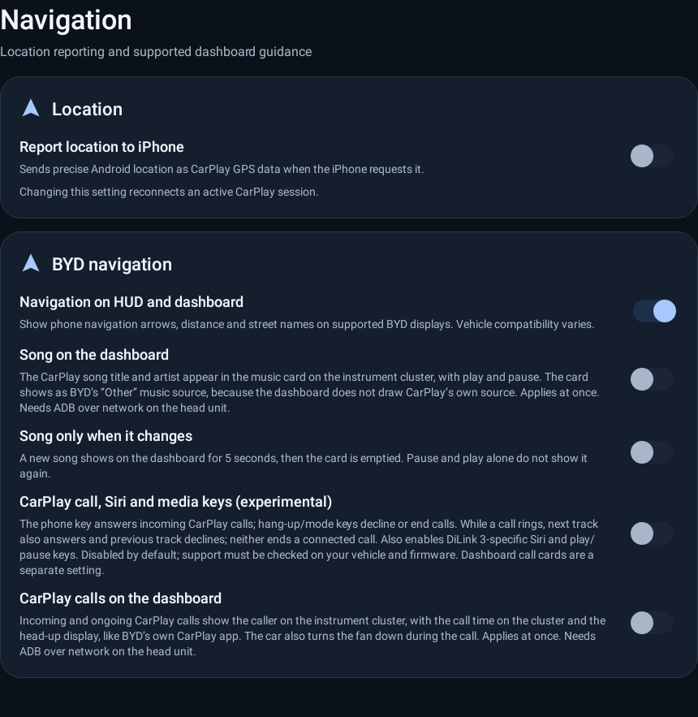
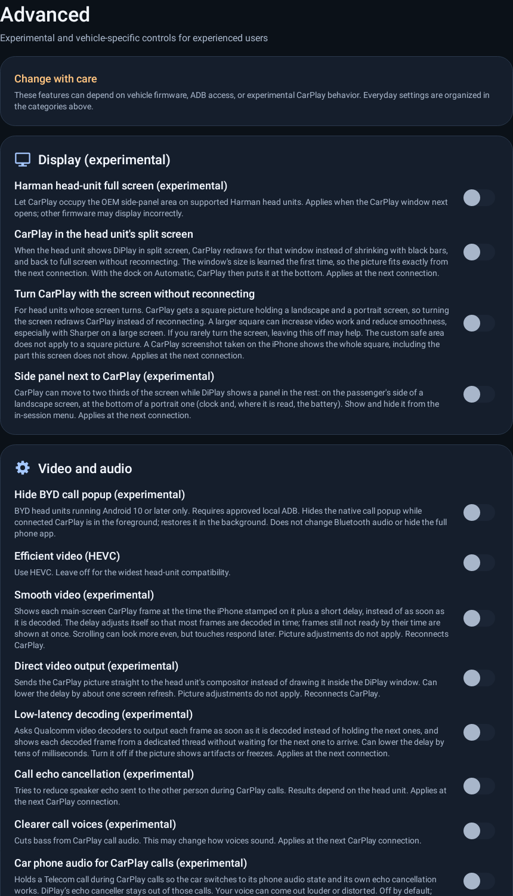
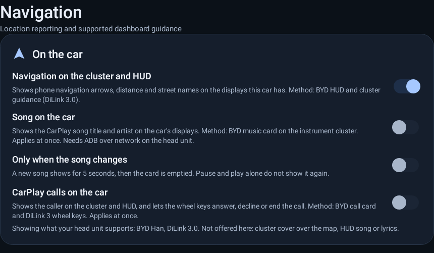
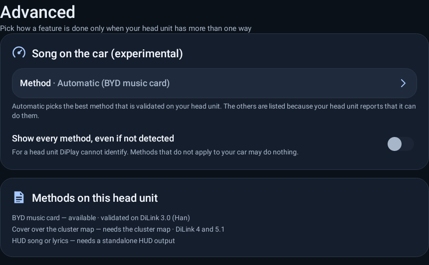
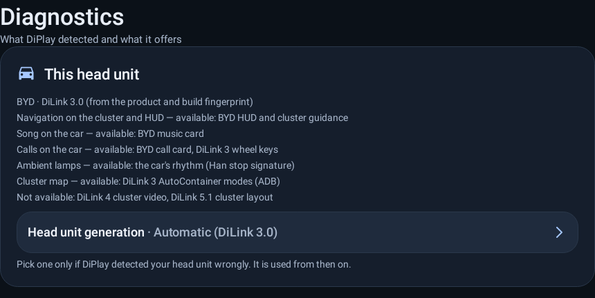

# RFC: one feature per outcome, several backends per head unit

Status: **draft for discussion** (docs only, no code change).
Scope: Settings and the BYD/Geely vehicle integrations. Based on `origin/main` at 143f4674.

## Why

`AGENTS.md` already says the Settings screen is "grouped by driver goal, not by implementation". The controls themselves still follow the implementation: when a new head unit generation, or a new contributor's approach, arrives, it gets its own toggle, its own preference and its own detection rule. The result is that a driver sees several switches for the same outcome and has to guess which one applies to their car.

This RFC proposes a way to keep every contributor's work and every head unit's special case, while the driver sees **one control per outcome**.

## What the code looks like today

Counts are from a scan of `DiPlayActivity.kt` (6,981 lines), `shared/.../hud`, `setup/DiLinkGeneration.kt` and the Settings strings.

- About 110 `toggle`/`choice`/`adbToggle` calls in `DiPlayActivity.kt`, in 21 `filteredSection` cards.
- The same outcome appears more than once:

| Outcome | Controls today |
| --- | --- |
| Song on the car | `settings_cluster_music` (album cover over the cluster map, `ClusterMusicSettings`), `cluster_song` with `cluster_song_gate` and `cluster_song_on_change` (BYD music card, `BydClusterSong`), `song_on_hud` (`BydStandaloneHudOutput`) |
| Calls on the car | `carplay_calls_on_dashboard`, `carplay_call_controls_experimental` (built in two places), `settings_hide_byd_call_popup`, `phone_audio_route` and `phone_audio_route_apps`, `call_echo_cancellation`, `call_voice_filter`, `settings_call_speakerphone` |
| Ambient lamps | `settings_ambient_enable`, `settings_ambient_music`, `settings_ambient_car_rhythm`, `settings_ambient_car_rhythm_feed` |
| Navigation on the cluster/HUD | `navigation_on_hud_and_instrument_cluster`, `settings_fce_cluster_guidance`, `oem_cluster_map`, `center_map_card`, `launcher_map_sharing`, `follow_instrument_theme_and_map_card`, `cluster_projection_shape`, `dashboard_map_only_in_small_and_full_navi` |
| Starting with the car | `connect_when_diplay_opens` (three places), `connect_when_iphone_bluetooth_connects`, `open_after_the_car_starts`, `auto_car_hotspot` (two places), `usb_auto_confirm` |
| Video path | `efficient_video`, `smooth_video`, `settings_direct_video_output`, `settings_low_latency_decoder`, `settings_mtk_decoder_tuning`, `settings_harman_fullscreen_experimental` |

- "Which head unit is this?" is answered in at least nine different ways:
  `DiLinkGeneration.detect` (used only by the setup guide), `DiLink51ClusterLayout.FINGERPRINTS`, `DiLink4ClusterDisplay.matches` (display name and size), `GeelyClusterDisplay.supported/matches`, the preferences `adb_cluster_activity_enabled` and `platform21_cluster_enabled`, `FceClusterBridge.available`, `BydStandaloneHudOutput.available`, package probes (`com.byd.amapservice`, SOME/IP), `CarHotspotSetup.isBydHeadUnit`, and `BydVehicleCapabilityProbe`.
- Different backends were written by different contributors for different head units, which is why the controls overlap: each contributor added what their car needed.

Real screenshots from the current build (BYD head unit, Navigation and Advanced pages). The Navigation page shows "Song on the dashboard" and "CarPlay calls on the dashboard" beside several other switches; the Advanced page is the long list of per-implementation switches.





## Proposal

### 1. One resolved head-unit profile

Detect once, at start-up, and expose **capabilities**, not versions. It wraps the existing detections, so there is no new guessing.

```kotlin
data class HeadUnitProfile(
    val generation: DiLinkGeneration,          // today only the setup guide reads this
    val fingerprint: String?,
    val displays: List<DisplayInfo>,           // name + size, e.g. fission_bg_xdjaVirtualSurface 1920x720
    val probes: Probes,                        // packages, services, ADB reachable, vehicle capability probe
)

sealed interface Support {
    object Yes : Support
    data class No(val reason: String) : Support
    data class Unknown(val reason: String) : Support   // never blocks; shown under "Show every method"
}
```

### 2. One feature per outcome, with backends

```kotlin
interface FeatureBackend {
    val id: String
    val validatedOn: List<String>        // e.g. "BYD-AUTO/DiLink3.0/DiLink3.0:10/QKQ1.210910.001/..."
    val experimental: Boolean
    fun support(profile: HeadUnitProfile): Support
    fun start(context: Context)
    fun stop(context: Context)
    fun diagnostics(): String
}

class Feature(val id: String, val backends: List<FeatureBackend>) {
    fun resolve(profile: HeadUnitProfile, override: String?): FeatureBackend? =
        backends.firstOrNull { it.id == override && it.support(profile) !is Support.No }
            ?: backends.firstOrNull { it.support(profile) == Support.Yes }
}
```

`BydCarMusicRhythm` already uses this shape: one interface with a Tang and a Han variant, picked at run time. This RFC generalises that.

Example, **Song on the car**, which today is three unrelated toggles:

```kotlin
val songOnCar = Feature("song_on_car", listOf(
    BydMusicCardBackend,          // today's cluster_song (BydClusterSong), DiLink 3 music card
    ClusterCoverOverlayBackend,   // today's settings_cluster_music (needs the cluster map)
    HudSongBackend,               // today's song_on_hud (BydStandaloneHudOutput)
))
```

### 3. What the driver sees

These are **mockups** rendered with the app's own widgets (a throw-away Robolectric test), not a finished implementation. Strings and layout are illustrative.

One switch per outcome, and the method named in the description:



A method picker appears only when the head unit supports more than one way, in Advanced:



A "this head unit" card in Diagnostics shows what was detected and what is offered, with a manual override for a wrong detection:



### 4. Compatibility and migration

- New unified preferences read the old keys once. The old keys decide the backend: for example, `cluster_song` on selects the BYD music card, and the cluster-music cover on selects the cover.
- `SettingsBackupCodec` maps old keys to the new ones in both directions, so a backup from an older version restores.
- While the profile is `UNKNOWN`, every method is shown, as the old toggles are today.

```kotlin
// one-time migration for "Song on the car"
fun migrateSongOnCar(prefs: SharedPreferences, legacy: LegacySongPrefs) {
    if (prefs.contains("song_on_car")) return
    val method = when {
        legacy.clusterSong -> "byd_music_card"
        legacy.clusterCover -> "cluster_cover_overlay"
        legacy.hudSong -> "hud_song"
        else -> null
    }
    prefs.edit().putBoolean("song_on_car", method != null)
        .apply { if (method != null) putString("song_on_car_method", method) }.apply()
}
```

### 5. Guard rails

- A registry test, next to `SettingsLayoutPolicyTest`, fails when a new control is added without a feature or without a category.
- A characterisation test per known head unit: given a recorded profile (fingerprint, displays, packages), the resolved backend for each feature must not change when the refactor lands.

```kotlin
@Test fun hanDiLink3ResolvesToItsValidatedBackends() {
    val han = HeadUnitProfile.fromFixture("BYD-AUTO/DiLink3.0/DiLink3.0:10/QKQ1.210910.001/eng.build.20260204.025317")
    assertEquals("byd_music_card", songOnCar.resolve(han, null)?.id)
    assertEquals("autocontainer_dilink3", clusterNavigation.resolve(han, null)?.id)
}
```

- The support matrix (feature by generation, with `validatedOn`) is generated into `docs/COMPATIBILITY.md` from the registry, so the documentation cannot drift.

## Plan

Each step is its own small PR and changes no behaviour until the pilot.

1. `HeadUnitProfile` that wraps the existing detections, with fixtures and tests.
2. Pilot: **Song on the car** (three toggles become one, three backends).
3. Calls on the car, then ambient lamps, then starting with the car.
4. Cluster and HUD navigation last: the largest and most head-unit-specific area, and the hardest to test without the car.

## Risks

- The maintainers cannot test DiLink 4 and 5 paths. The refactor must keep behaviour identical and keep the old controls reachable while the profile is unknown.
- Preference migration must not lose settings or break backup and restore.
- Fewer controls means the "Advanced" method picker has to stay easy to find for owners of unusual cars.

## Not in this proposal

- Removing any contributor's implementation.
- Changing what any head unit does by default.
- New vehicle features.

## Questions for review

1. Is a profile plus backends the right shape, or would you rather keep per-feature gating and only merge the duplicate toggles?
2. Is "Song on the car" a good pilot?
3. Should unknown head units see every method (as proposed) or only the generic one?
