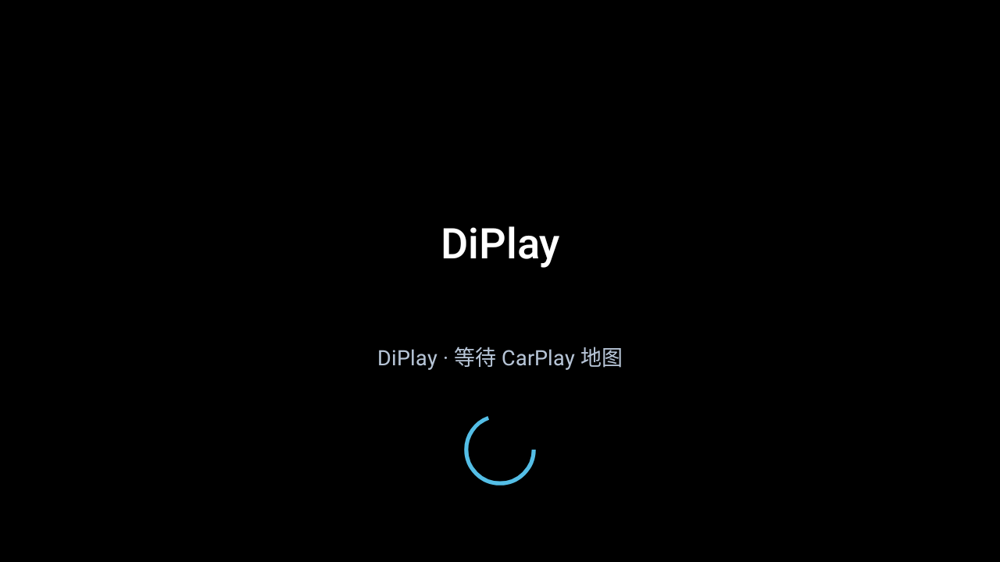

# 加载动画与等待页面

我在23款唐 DM-i 冠军版平台21上遇到过连接和仪表地图切换时短暂黑屏。这次给公共版补上 DiPlay 自绘等待画面，不包含 Apple 标识、Ultra 标识和车内截图。

中控在主视频流开始、首帧还没有显示时展示加载画面，收到有效会话的首帧回调后立即隐藏。最长五秒自动让出画面，避免缺失回调挡住地图。平台21使用的独立仪表 Activity 按 TextureView 实际呈现隐藏；断线保留等待页，动画最多运行五秒。已有 Presentation 路径也复用此组件，SurfaceView 按当前解码器的首帧输出隐藏，信号缺失时靠五秒上限让出。等待页限定在原有视频区域内，转弯卡、音乐和车速层仍位于它上方；不创建系统覆盖窗口，不接管原车安全信息。

本次只移植等待显示，不增加外部镜头管理。原有连接页、恢复按钮和诊断流程继续使用。本地验证覆盖首帧隐藏、超时隐藏、旧超时取消及大字体合成截图。自用版的实车观察是问题来源，本次公共分支没有安装上车，仍需维护者和车友核验不同固件的 SurfaceView 显示次序。

@Hanxu4131（寒叙）

## 本次公共分支验证

本次公共主线的完整 CI 已通过：shared 1554 项、common 1467 项、home 6 项，失败与错误均为 0，跳过 1 项；mobile/home/maphost 的 lint 与 debug 构建均通过，公开树检查和 diff-check 也通过。 中文截图与来源注释修订已另经同锁定向测试。

